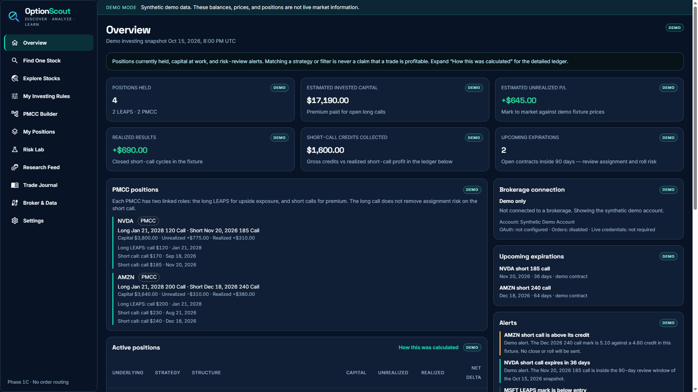
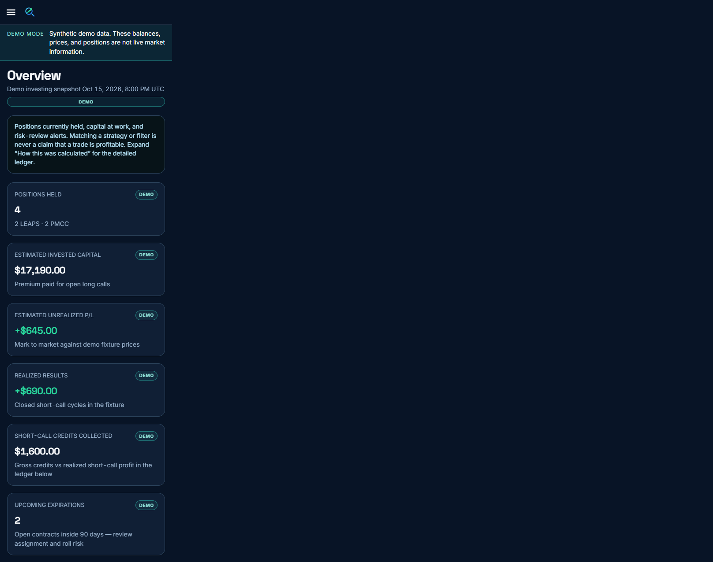
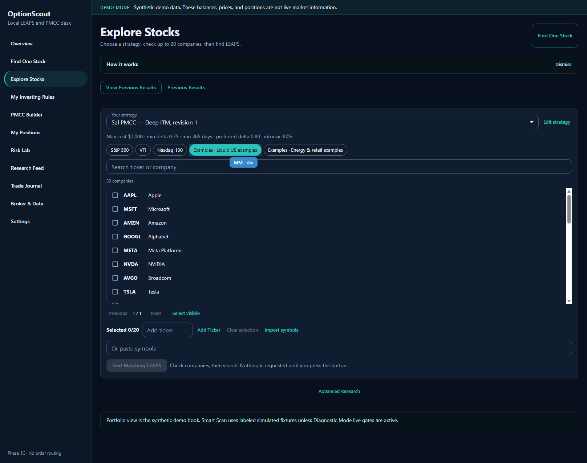
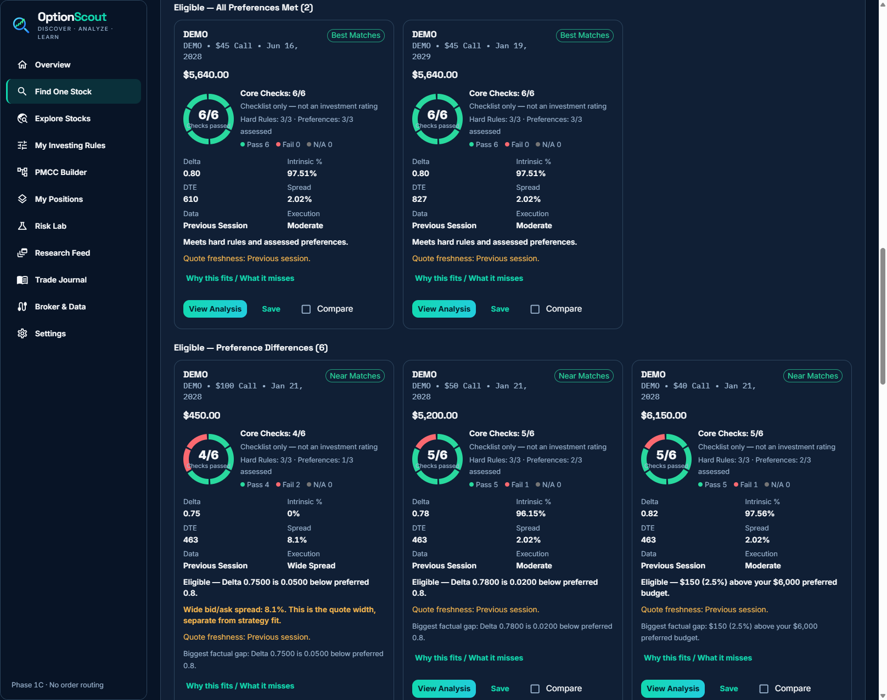
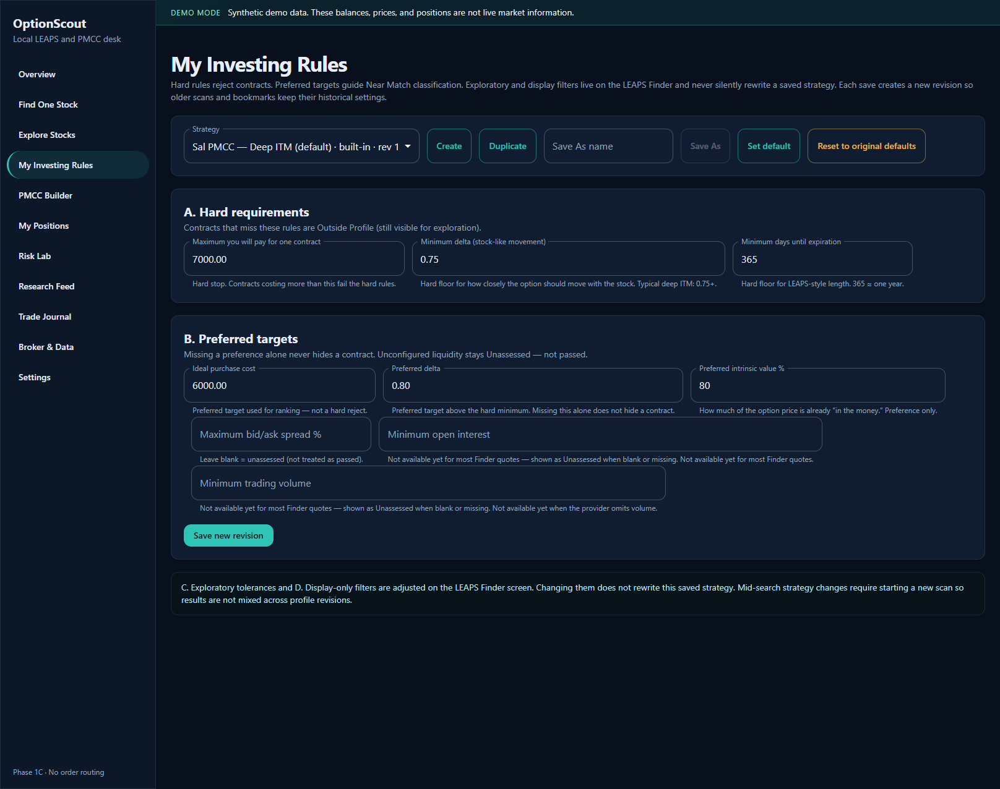

# OptionScout


A free, local-first LEAPS options research application that helps investors discover stocks, evaluate long-dated calls against personalized strategies, and understand their existing options positions.

OptionScout is educational research software. It is not a brokerage, a trading bot, or a financial advisor. It does not place orders, and it does not tell you what to buy.

You can learn the workflow with a built-in simulated book. Connecting a brokerage account is optional, and that connection is read-only.

## Try it on one screen

1. From the project directory, run `sh scripts/setup.sh --start` (or `.\scripts\setup.ps1` and `docker compose up -d --build` on Windows).
2. Open [http://127.0.0.1:3180](http://127.0.0.1:3180). Overview is the simulated book. It does not need a passphrase.
3. On Find One Stock, search `DEMO`. A local install asks you to create a passphrase first. Set `PUBLIC_SIMULATED_DEMO=true` only when you want that simulated `DEMO` search, and the four research pages, to work without sign-in. Orders and broker changes stay refused.
4. Open PMCC Builder, Risk Lab, Research Feed, and Trade Journal. They use the simulated book. They do not place orders. Faircloth OS stays off.

## What you can do today

**Find One Stock.** Look at long-dated calls on one company, including a fund ticker such as a single ETF. In the simulated portfolio view, the practice chain is the fictional ticker `DEMO`.

**Explore Stocks.** Pick a saved strategy, choose companies, and evaluate LEAPS. You can check up to 20 companies. Each research step looks at 12 of them. If you leave the page open, the next step can examine the rest. Pause keeps the results you already have.

**Bring your own ticker list.** Import a CSV of symbols, add a ticker by hand, or start from a small curated example list. Those example lists are application samples. They are not official index membership files.

**Open a large directory.** Explore Stocks includes research snapshots of the S&P 500, Nasdaq-100, and VTI company lists. Pick one and the companies are already there. Importing a fund holdings file is optional and replaces that snapshot for the matching fund.

**Save an investing strategy.** The built-in example is Sal PMCC — Deep ITM, revision 1. It shows how rules are stored. It is not a recommended investment strategy, and it is not a later private revision of a personal profile. You can copy it and change the numbers. Revisions you save stay in your local database.

**Read the result groups.** Best Matches have passed every configured hard rule and preference that could be assessed. Near Matches passed the hard rules and missed a preference. Contracts with a missing or invalid quote are not presented as matches. A bid/ask spread of 5% or wider is a display warning. It does not change the match decision.

**See the contract details that were actually checked.** Quotes, Greeks, spread, and contract cost are shown with the data source. Simulated results say so. A saved result is not refreshed just because you open it.

**Come back later.** Research sessions, bookmarks, and comparisons stay in the local database. View Saved Research reopens that session. It does not request a new scan.

**Connect tastytrade as a read-only source.** When you turn this on, OptionScout can import positions and transactions and can request chains only after you start a search. Scheduled synchronization is not available. Order entry is rejected at startup.

**Review a portfolio.** The simulated Overview is a fictional book of long calls and poor man's covered calls. After you sign in and choose the brokerage portfolio, Overview and My Positions use your imported records instead. A confirmed PMCC shows the long call and the short call separately. Missing, stale, or incomplete figures stay labeled that way. Realized profit is not shown as verified when the accounting is incomplete.

## Research desk

These screens work on the simulated book. They do not submit orders.

- **PMCC Builder** pairs a long DEMO call with a shorter call and shows debit, profit, loss, breakeven, intrinsic and extrinsic value, and whether the pair passes your saved rules.
- **Risk Lab** charts modeled P/L at expiration and at a chosen date, with sliders for price, IV, and days passed.
- **Research Feed** lists saved searches and notable simulated matches. Faircloth OS is not connected.
- **Trade Journal** stores date, ticker, strategy, entry, exit, notes, tags, and outcome in the local database, with a win-rate summary and CSV export.

Confirmed PMCC relationships are reviewed on Overview. PMCC Builder saves a hypothetical plan in the local database. It does not create a brokerage position. Streaming quotes are not opened at startup. OptionScout never routes an order.

## Screenshots

These pictures are from the simulated book and simulated research. They are not a brokerage account.











## Quick start

You need Docker Desktop, or another Docker engine with Compose v2. You do not need a brokerage account to try OptionScout.

This path was verified on Windows 11 with PowerShell and Docker Desktop. On Linux with Docker, `sh scripts/setup.sh --container optionscout-linux --port 3197` created `secrets/tastytrade.env` from the blank template when that file was missing and printed `docker exec -it optionscout-linux`. Running the same command with `--start` built the image and started that container. A health check on `http://127.0.0.1:3197/api/health` reported demo mode with orders disabled. The passphrase command printed by the script uses the container name from `--container` (default `optionscout`).

1. Clone OptionScout.
2. Run the setup script for your system.
3. Start Docker.
4. Create your own local owner passphrase. There is no shared password.
5. Open OptionScout in the browser.

From the project directory on Windows:

```powershell
.\scripts\setup.ps1
docker compose up -d --build
docker compose exec -it optionscout node apps/api/dist/owner-setup.js
```

Then open [http://127.0.0.1:3180](http://127.0.0.1:3180). The Overview loads immediately. Sign in on Broker & Data with the passphrase you just created before you start a search.

On macOS or Linux, `--start` builds and starts the container. Without `--start`, the script only prepares the blank secret file and prints the next command.

```sh
sh scripts/setup.sh --start
docker exec -it optionscout node apps/api/dist/owner-setup.js
```

A second copy can set the container name. The success text uses that name:

```sh
sh scripts/setup.sh --container optionscout-fresh --port 3197 --start
docker exec -it optionscout-fresh node apps/api/dist/owner-setup.js
```

You can skip the passphrase and still read Overview. Create one when you want saved rules, bookmarks, or a search. `PUBLIC_SIMULATED_DEMO=true` is the explicit opt-in that allows a simulated `DEMO` search from a non-loopback host without that passphrase. It does not load broker credentials, and it refuses order routes and broker changes. Leave it unset for a normal local install.

The app is published only on your computer, at [http://127.0.0.1:3180](http://127.0.0.1:3180). Port 3180 is the default. To use another local port for a second copy:

```powershell
$env:OPTIONSCOUT_PORT = "3197"
$env:OPTIONSCOUT_CONTAINER = "optionscout-fresh"
$env:OPTIONSCOUT_IMAGE = "optionscout:fresh"
$env:COMPOSE_PROJECT_NAME = "optionscout-fresh"
docker compose up -d --build
```

`OPTIONSCOUT_IMAGE` keeps that second build from moving the `optionscout:1b` tag your existing app is using.

Check that it started:

```powershell
curl.exe http://127.0.0.1:3180/api/health
```

A healthy response has `"status":"ok"` and `"ordersEnabled":false`. `"demo":true` means the simulated book is installed. It does not mean your brokerage records were replaced. See [Why the health check says demo](#why-the-health-check-says-demo).

### Create your passphrase

The simulated Overview is visible before sign-in. Searches, saved strategies, and bookmarks require a local owner passphrase unless `PUBLIC_SIMULATED_DEMO=true`. OptionScout does not ship with a password. The setup script does not ask for the passphrase. Create it only when you want those signed-in features.

After the container is healthy:

```powershell
docker compose exec -it optionscout node apps/api/dist/owner-setup.js
```

Use 12 or more characters. The prompt is masked. Do not pass the passphrase as an argument. Then open Broker & Data and sign in.

If you are not using Docker, the same command is `npm run owner-setup` after `npm ci` and `npm run build`.

### Learn without a brokerage account

1. Leave `secrets/tastytrade.env` blank.
2. Leave the portfolio view on Demo. That is the default.
3. Read the Overview. The sample positions are NVDA, AMZN, AAPL, and MSFT. The banner says DEMO MODE.
4. Sign in. Open Find One Stock and research the fictional ticker `DEMO`. The page labels the chain as simulated.
5. Open Explore Stocks, choose a curated example, and run Find Matching LEAPS. Those prices are simulated fixtures, not live quotes.
6. Open My Investing Rules to see the example strategy, Sal PMCC — Deep ITM revision 1. That screen is the built-in template. It is not a recommendation and it is not a private later revision.

Simulated rows never enter the brokerage position tables. Switching Settings to the brokerage portfolio does not delete the demo book. It only changes which book the screen reads.

### Connect your own tastytrade account

Do this only if you want read-only access to your own account. Market data then depends on your provider permissions and on tastytrade being available. OptionScout cannot give you the right to redistribute those quotes.

1. Create a personal OAuth application in the [tastytrade developer portal](https://developer.tastytrade.com/). Use the refresh-token grant and request the `read` scope only. Do not request `trade`.
2. Copy `secrets.example/tastytrade.env.example` to `secrets/tastytrade.env` if setup did not already do that.
3. Fill in `TASTYTRADE_CLIENT_ID`, `TASTYTRADE_CLIENT_SECRET`, and `TASTYTRADE_REFRESH_TOKEN`. Set `TASTYTRADE_ENVIRONMENT` to `production` or `sandbox` to match the application you created. The two environments do not share credentials.
4. In the project `.env` file, which Compose reads for these settings, set:

```text
TASTYTRADE_ENABLE_LIVE=true
FINDER_LIVE_SCAN=true
SMART_SCAN_LIVE=true
```

5. Recreate the container: `docker compose up -d --force-recreate`. Startup still does not scan or import until you ask.
6. Sign in, open Settings, choose the brokerage portfolio, and turn on on-demand search. Then use Broker & Data when you want to import. Start a search only when you want market data.

This install keeps one brokerage account. After Test Connection, confirm the only account or choose one when the grant can see several. The screen shows the account type and a masked number. Import / Refresh Positions reads only that account, and only after you choose it. A later choice of a different account or environment is refused. Existing history is not cleared or combined. Use a separate Docker data volume for the other account. After you sign in, Broker & Data can store the client id, client secret, and refresh token on the local data volume. It does not return them to the browser. Saving credentials does not connect, import, or scan. Disconnect keeps that choice after a restart and does not fall back to an older secret file. `TASTYTRADE_DISABLE_LIVE=true` blocks every provider call, including Test Connection. A local file is not encryption at rest, and a backup of the Docker data volume can include the credential file. Revoking the grant at tastytrade is a separate step.

A Saved LEAPS Idea is one hypothetical long call. A Saved PMCC Setup is two hypothetical calls on the same underlying, with the short call expiring first and its strike above the long strike. If the long strike is at or above the short strike, the pair is stored and labeled as not a conventional PMCC. Saving an idea does not check delta, intrinsic value, or profitability, and the idea is excluded from holdings and profit figures.

Demo onboarding has been tested on an isolated install: blank secrets, a local passphrase, the simulated book, and a simulated `DEMO` search. Real personal tastytrade OAuth onboarding has not been independently tested end to end. The refresh-token grant, `read` scope, User-Agent requirement, and separate production and sandbox hosts match the tastytrade OAuth guide as checked for this release. A live token exchange was not run. The steps above were checked against the local configuration parser and a blank secret file. A live token exchange was not run. Use your own application and your own refresh token. OptionScout never needs someone else's credentials or database.

To disconnect, set those three values back to `false`, clear `secrets/tastytrade.env`, and recreate the container. Also revoke the OAuth application or refresh token in tastytrade. OptionScout does not keep the access token on disk. Revoking the refresh token at the provider stops new access even if a local copy remains.

The provider allowlist rejects order paths. `ENABLE_ORDER_EXECUTION` cannot be set to anything but `false`.

## Start, stop, restart, and update

Stop the app and keep the database:

```powershell
docker compose stop
```

Start it again:

```powershell
docker compose start
```

Restart the same container:

```powershell
docker compose restart
```

Update after you pull new code. This rebuilds the image and keeps the database volume:

```powershell
docker compose up -d --build
```

Before you rebuild, keep the image you are running:

```powershell
docker tag optionscout:1b optionscout:v0.1.0
```

Remove the container and keep the database:

```powershell
docker compose down
```

`docker compose down -v` deletes the database volume. Do not use it if that volume holds research you want to keep.

## Where your data lives

Docker stores SQLite at `/data/optionscout.sqlite` in the named volume `optionscout_optionscout-data`. The volume survives stop, restart, and rebuild. It is removed only by `docker compose down -v` or by deleting that volume yourself.

A second Compose project name gets its own volume. The setup above uses `optionscout-fresh` for that reason.

Without Docker, the database file is `apps/api/data/optionscout.sqlite`.

Migrations run forward when the app starts. An existing database keeps its rows. OptionScout does not ship a migration that copies demo fixtures into brokerage tables.

Backups are ordinary SQLite files. Stop the app before you copy the file. Do not commit a database, a backup, or `secrets/`.

## Run the tests

```powershell
npm ci
npm test
npm run build
```

`npm test` builds the shared package, then runs the shared, API, and web suites. The API and web tests use fixtures and mocks. They do not need brokerage credentials.

For interface work, stop anything already bound to port 3180, then:

```powershell
npm run dev:api
npm run dev:web
```

The API listens on port 3180. Vite listens on [http://127.0.0.1:5173](http://127.0.0.1:5173) and proxies `/api` to it.

Node.js 22 or newer is required for a non-Docker run. The Docker image supplies its own Node 22.

## Why the health check says demo

`DATA_MODE` is required to be `demo`, and `/api/health` reports `demo: true` on every boot. That flag means the simulated book is part of the application. It is not a switch that mixes simulated quotes into brokerage research.

The simulated book lives in its own tables and is marked as demo data. Brokerage positions, transactions, and quote snapshots live in other tables. Overview reads the simulated book only while Settings is on the demo portfolio. In the brokerage portfolio it reads the imported book. The app still requests the demo dashboard in the background so the demo screen can be opened later. Those figures are not added to the brokerage cards.

A search uses simulated chains when the portfolio view is demo, or when the live search switches are off. A live search does not fall back to those fixtures.

## Do not expose this app to the internet

Compose publishes `127.0.0.1` only. The sign-in cookie is for that local HTTP origin. Do not port-forward OptionScout, put it on a public host, or disable the loopback checks. It is a single-user local tool. It does not include public-internet authentication or TLS.

## Project layout

```text
apps/web          React, Vite, and MUI
apps/api          Express, SQLite, and migrations
packages/shared   Zod contracts shared by the API and the web app
docker            Container image
docs              Architecture and development notes
scripts           Local setup helpers
secrets.example   Blank brokerage template
```

More detail:

- [Contributing](CONTRIBUTING.md)
- [Architecture](docs/architecture.md)
- [Development](docs/DEVELOPMENT.md)
- [Security](SECURITY.md)

## License

OptionScout is released under the [MIT License](LICENSE). A public `v0.1.0` tag is a clean publication snapshot. It will not have the same Git commit ID as a private development tag that uses the same name.

Copyright (c) 2026 Sal Talks Life. OptionScout is the name of the application. The MIT license covers this source tree. It does not cover third-party fund holdings files or market data from a brokerage.

The MIT license applies to OptionScout source code, its documentation, and the fictional screenshots in `docs/images/`. It does not give anyone the right to redistribute third-party fund holdings files or market data from a brokerage or quote provider. Download holdings files from the fund company yourself, and use live quotes only under your own provider agreement.
