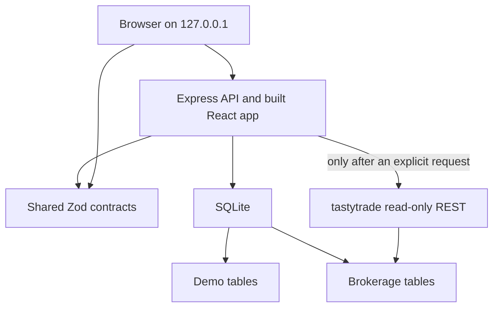
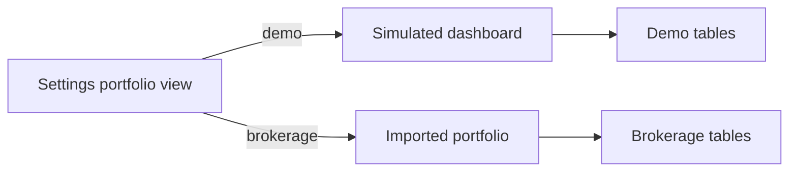

# Architecture

OptionScout is one local website and one local API. The browser talks only to that API. The API stores research and portfolios in SQLite. It calls tastytrade only after you enable read-only access and then ask for an import or a search.

Docker runs that process in one container. Compose publishes `127.0.0.1` and mounts a named volume at `/data`.

## How the browser talks to the API

The web app is a React router inside `apps/web`. In Docker it is the static build served by Express. In development, Vite on port 5173 proxies `/api` to the API on port 3180.

`apps/web/src/api/client.ts` fetches JSON and parses it with the same Zod schemas the API uses before it responds. A payload that does not match the contract is rejected on both sides.

Sign-in posts the passphrase to `/api/session`. The API sets an HttpOnly cookie and returns a CSRF token. Later changes send that token back. Reading the simulated Overview does not require sign-in. Starting a search, saving a strategy, or reading imported positions does.

## Brokerage access

Credentials live only in `secrets/tastytrade.env`. The API refuses to start if those values are copied into the process environment. When live access is off, the secret file is not kept in memory.

When live access is on, the API exchanges the refresh token for a short-lived access token and keeps that token in memory. The tastytrade client allowlist is read-only. A path that would place an order is rejected before it is sent. `ENABLE_ORDER_EXECUTION` cannot be turned on, and scheduled synchronization cannot be turned on. Boot does not import positions and does not open a chain.

DXLink streaming has a protocol implementation. The live diagnostic switch defaults off, and startup does not open a socket. REST snapshots remain the quote source used by the portfolio screens.

## What SQLite stores

One database file holds both books.

The simulated book uses `positions`, `option_legs`, `transactions`, `marks`, and the related journal and watchlist tables. Those rows are marked demo. Startup seeds them once. The seed version is stored in `app_meta`. A later boot does not insert a second copy, and it refuses to mix two seed generations.

The brokerage book uses `broker_accounts`, `broker_positions`, `broker_transactions`, `quote_snapshots`, `strategy_groups`, and `strategy_members`. Portfolio math reads these tables only. Deleting a confirmed PMCC link removes the link, not the imported contracts.

Research uses `strategy_profiles`, `strategy_profile_revisions`, `research_sessions` and their company and candidate tables, `finder_bookmarks`, `market_data_observations`, and `discovery_universes`. Saved revisions are kept. The current revision number points at the one a new search uses.

Migrations in `apps/api/migrations` run in filename order. A migration already recorded in `schema_migrations` is skipped. New work adds a new file. It does not edit a shipped file.

## Research sessions

A Find One Stock search and an Explore Stocks search each create a session. The session stores the companies, the contracts that were evaluated, and the observations used to classify them.

Opening a saved session reads that row. It does not call the provider. The web app keeps a generation token so a slow "restore the latest session" response cannot replace a search you just started. Pause tells the page not to start the next company step. It does not delete the completed results. Continue Search asks for the next bounded step. Run New Search creates a different session.

## How a multi-company scan stays bounded

Explore Stocks lets you check up to 20 companies. The scan operation itself accepts at most 12 companies. The page sends the first 12, waits until that step is finished, and then requests the next companies only if the page is still open, you have not paused, and the step completed. Each of those requests is its own operation. The queue of remaining companies stays in the session.

Find One Stock evaluates one underlying at a time. In the demo portfolio, that underlying must be the fictional ticker `DEMO`. Real symbols in that mode are refused rather than filled with the multi-company fixture.

## Quotes, Greeks, and match groups

Each contract observation records the quote, the Greeks, and whether those values were usable. An invalid quote is reported before a strategy match. Missing Greeks stay missing. They are not guessed.

Best Matches require every configured hard rule and every configured preference to be assessed and passed. A preference that could not be assessed is Need More Data, not a Best Match. Near Matches passed the hard rules and missed a preference. A bid/ask spread of 5% or wider adds a warning on the card. That warning does not change the classification and does not change the saved strategy.

`market_data_observations` is the history of what a search saw. `quote_snapshots` is the latest brokerage mark used by the portfolio. Opening an old research session shows the saved observation. It does not overwrite that history with a new quote.

When live mode is on, a missing chain stays missing. The API does not substitute the simulated fixture.

## Demo data and brokerage data

`/api/health` reports `demo: true` on every boot because the simulated book is always installed. That is not a statement that the screen in front of you is fictional. The banner and the portfolio view make that distinction.

The brokerage Overview still loads the demo dashboard in the background. The cards on that screen are built from `/api/broker/portfolio`. Demo totals are not added to those cards. If the demo dashboard request failed, the current page waits on it before showing the brokerage book. The figures themselves stay separate.

Simulated Explore Stocks results are generated in `apps/api/src/finder/smart-mock.ts` and labeled simulated. They are not provider quotes and they are not written into brokerage tables.

## Portfolio Overview

The brokerage screen uses the existing accounting reconstruction. It does not calculate a new profit formula in the browser.

Headline cards use known values only. A missing mark is Partial or Unavailable, not zero. Long-call remaining basis and long-call mark value count long calls only. Unrealized P/L on the headline adds open long and short calls when both marks exist, and it does not show a percentage. Realized P/L stays "Needs reconciliation" while fees or cycles are incomplete. The partial dollar amount stays inside Advanced Portfolio Details.

Expiration countdowns use today's calendar date. They do not rewrite the stored snapshot. A confirmed PMCC shows the long leg and the short leg separately, and each leg's amount is labeled estimated unrealized P/L.

## Adding a feature without breaking the numbers

- Put a shared decision in `packages/shared` and test it there.
- Read brokerage dollars from the accounting module. Do not recompute them in a component.
- Label incomplete data. Do not coerce it to zero or to a confident gain.
- Add a migration instead of changing an old one.
- Keep a new provider call behind an explicit user action.
- Add a mocked test for the demo path and, when the change touches import math, a fixture test that does not use a live account.
